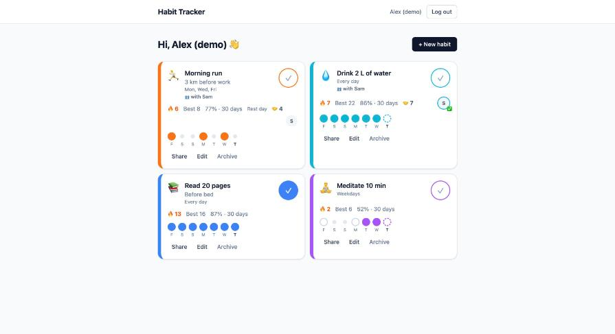
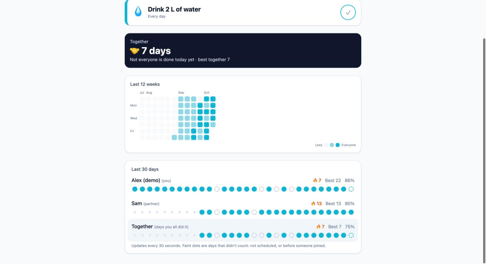
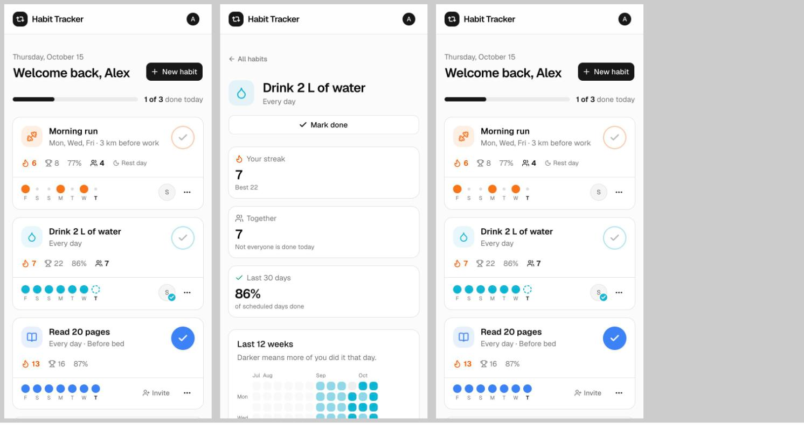
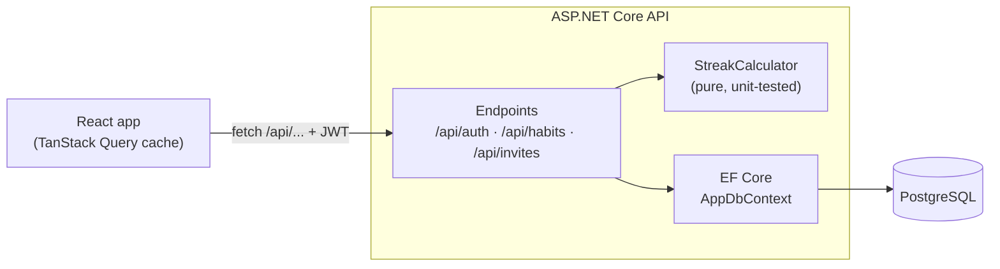
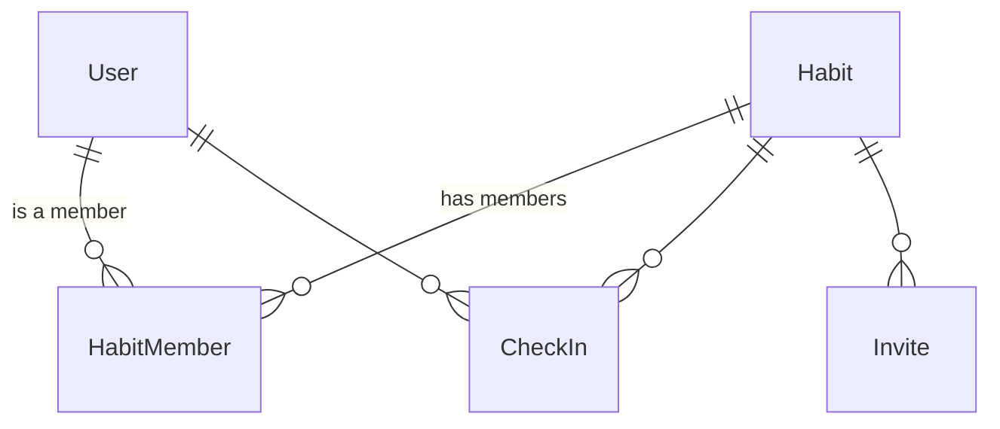

# InSync – you two, synced up

A social habit tracker: check in on your daily habits, keep your streaks alive, and share a habit with a friend so you can see each other's progress and build a **joint streak**.



## Try it

**Live:** https://habit-tracker-api-gw-hjbvg0c4cfhzfdg9.northcentralus-01.azurewebsites.net — create an account, add a habit, and invite a friend with a link.

It runs on free tiers, so the first visit after a quiet period can take 10–30 seconds while the server wakes up.

## Features

- **Habits on your schedule:** pick the weekdays that count (every day, weekdays, Mon/Wed/Fri…), plus an emoji and a color.
- **One-tap check-ins:** the card updates instantly (an optimistic update) and rolls back if the server says no.
- **Fair streaks:** rest days never break a streak, and today isn't "missed" until it's over. Current streak, best streak, 30-day completion rate.
- **Track together:** invite a partner with a single-use link that expires in 7 days. You see their ✅ when they're done, both of your streaks, and a joint streak of the days you *both* did it.
- **Habit detail page:** everyone's last 30 days side by side, plus a 12-week calendar heatmap.
- **Live-ish updates:** the page asks for changes every 30 seconds and whenever you come back to the tab.
- **Works on phones**, with keyboard focus outlines, screen-reader labels and readable contrast.

| Habit detail | On a phone |
| --- | --- |
|  |  |

## Tech stack

| | |
| --- | --- |
| **Frontend** | React 19, TypeScript (strict), Vite, TanStack Query, React Router, Tailwind CSS 4 |
| **Backend** | ASP.NET Core (.NET 10) minimal APIs, EF Core 10, JWT authentication, rate limiting |
| **Database** | PostgreSQL 17 |
| **Tests** | xUnit, covering the streak, joint streak and heatmap logic |

## Architecture



- **The browser talks only to `/api`.** In development, Vite's proxy forwards those calls to the API, so there's no CORS setup.
- **Who you are:** the API issues a signed JWT at login; every request sends it, and the API checks it.
- **What you may see:** every habit endpoint checks your membership in *that* habit. Non-members get 404, and partners can't edit or archive (403).
- **The interesting logic is pure:** streaks, the joint streak and the heatmap take dates in and give numbers out. No database and no clock, so they're easy to test.



A habit has one **owner** and partners (`HabitMember.Role`). A **check-in** is one user, one habit, one calendar day, unique per (habit, user, date).

## Run it locally

You need the [.NET 10 SDK](https://dotnet.microsoft.com/download), [Node.js 22+](https://nodejs.org) and PostgreSQL 17.

**1. Start a database.** Pick one:

```bash
# Option A: Docker (uses docker-compose.yml)
docker compose up -d

# Option B: Homebrew on macOS
brew install postgresql@17 && brew services start postgresql@17
createdb habittracker
```

**2. Configure the API.** Secrets live in .NET user secrets, outside the repo:

```bash
cd backend/src/HabitTracker.Api
# Docker (option A):
dotnet user-secrets set "ConnectionStrings:Default" "Host=localhost;Database=habittracker;Username=habit;Password=habit_dev_password"
# Homebrew (option B): your macOS user, no password
dotnet user-secrets set "ConnectionStrings:Default" "Host=localhost;Database=habittracker;Username=$(whoami)"

# Any random string of 32+ characters:
dotnet user-secrets set "Jwt:Key" "$(openssl rand -base64 48)"
```

**3. Create the tables and start the API** (on http://localhost:5080):

```bash
dotnet tool restore
dotnet ef database update
dotnet run
```

**4. Start the frontend** in a second terminal (on http://localhost:5173):

```bash
cd frontend
npm install
npm run dev
```

**Run the tests:**

```bash
cd backend && dotnet test
```

## Project structure

```
backend/
  src/HabitTracker.Api/
    Domain/       entities: User, Habit, HabitMember, CheckIn, Invite
    Data/         AppDbContext, migrations
    Contracts/    request/response DTOs
    Endpoints/    minimal API route groups
    Services/     StreakCalculator, TokenService, LocalDate
  tests/HabitTracker.Api.Tests/
frontend/src/
  api/            typed fetch client, TanStack Query hooks
  auth/           AuthContext + useAuth
  components/     HabitCard, Heatmap, MemberProgress, ShareDialog…
  pages/          Landing, Login, Register, Dashboard, HabitDetail, Invite
```

## Roadmap

- [x] v1: habits, check-ins and streaks, partners and joint streaks, heatmap
- [ ] Deploy: Neon Postgres, Azure App Service and Static Web Apps, GitHub Actions
- [ ] Real-time partner updates with SignalR, and a "nudge" button
- [ ] Reminders, groups and challenges, achievements

The full plan is in [PLAN.md](PLAN.md), with details in [BLOCKS.md](BLOCKS.md).
